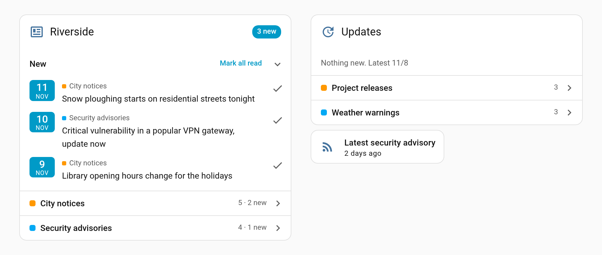
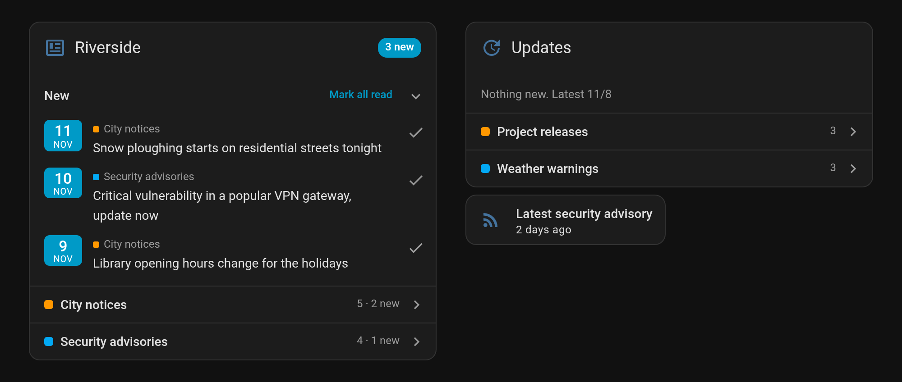

# Feed entries

Home Assistant integration that keeps an RSS or Atom feed's newest entries in a sensor, for dashboard cards that show
feeds.

[![GitHub Release][releases-shield]][releases] [![GitHub Release Date][release-date-shield]][releases] [![Downloads][downloads-shield]][releases] [![Marketplace][marketplace-shield]][marketplace] [![License][license-shield]](LICENSE)




## What is it?

An integration for following news, notices and advisories that come as RSS or Atom feeds. Each feed you add becomes a
sensor whose state is when its newest entry was published, and whose `entries` attribute lists its newest entries,
each with its title, link, id and date.

Home Assistant's own Feedreader keeps only the newest entry of a feed, which is enough to trigger an automation but not
to show a list. This integration keeps a list, in the shape the [feedparser](https://github.com/custom-components/feedparser)
integration writes, so cards made for feedparser read it too. Unlike feedparser, it is set up from the UI, its sensors
can be renamed and moved like any other, and its dates are always ISO 8601.

[Feeds card](https://github.com/jesmak/feeds-card) shows the feeds, each a list of its own, with the entries you haven't
seen gathered above them.

## Installation

### With the Marketplace

1. Open Settings › Marketplace, choose Add from link and paste `https://github.com/jesmak/feed_entries`
2. Open Feed entries in the Marketplace and choose Install
3. Restart Home Assistant
4. Add the integration in Settings › Devices & services, and give it a feed's address

### Manual

1. Download the source code from the latest release
2. Copy the `custom_components/feed_entries` folder to your Home Assistant installation's `config/custom_components`
   folder
3. Restart Home Assistant
4. Add the integration in Settings › Devices & services, and give it a feed's address

## Settings

Each feed is an entry of its own, so a second feed is added the same way as the first. Adding one reads the feed once,
and refuses an address that doesn't answer or answers with something other than RSS or Atom, such as the site's front
page. The same address can't be added twice.

| Name    | Type   | Description                                                       | Default              |
| ------- | ------ | ----------------------------------------------------------------- | -------------------- |
| Address | string | The address of the feed itself, not of the site it belongs to     | required             |
| Name    | string | Names the feed's device and sensor, and so the sensor's entity id | the feed's own title, else the address |

**Configure** on an entry changes how much it keeps and how often it is fetched. Saving reloads the entry.

| Name            | Type   | Description                                                      | Default |
| --------------- | ------ | ---------------------------------------------------------------- | ------- |
| Entries kept    | number | How many of the feed's newest entries the sensor holds, 1 to 200 | 20      |
| Update interval | number | How often the feed is fetched, in minutes, 5 to 1440             | 60      |

A feed is asked for with the ETag and date it last came with, so a server that supports them answers an unchanged feed
with a short "not modified".

## Sensors

One sensor per feed, on a device of its own named like the feed.

| State or attribute | What it holds                                                                                                   |
| ------------------ | --------------------------------------------------------------------------------------------------------------- |
| State              | When the newest entry was published, a timestamp. A new entry changes it. Unknown when no entry has a date      |
| `entries`          | The newest entries, newest first when all have a date and in the feed's own order otherwise, up to Entries kept |
| `feed_title`       | The feed's own title                                                                                            |
| `feed_link`        | The link the feed gives for itself, usually its site. Left empty unless it is an http or https address          |

Each entry in `entries` is an object with these fields.

| Field       | What it holds                                                                                                                  |
| ----------- | ------------------------------------------------------------------------------------------------------------------------------ |
| `id`        | The entry's own id, such as an RSS guid. Without one its link, and without that its title                                      |
| `title`     | Its title, or its link when it has none                                                                                        |
| `link`      | Where it leads, when it has a link                                                                                             |
| `published` | When it was published, or last updated when the feed gives only that, as ISO 8601 in UTC. Left out when the feed gives neither |

An entry with neither a title nor a link is left out. `entries` is kept out of the recorder, as it is what a dashboard
shows now and a copy of it at every change would only fill the database. The state and the other attributes are
recorded as usual. When the feed can't be fetched, the sensor is unavailable until it can.

## Examples

### A new security advisory as a notification

```yaml
triggers:
    - trigger: state
      entity_id: sensor.security_advisories
      not_from: unavailable
      not_to: unavailable
actions:
    - action: notify.notify
      data:
          title: New security advisory
          message: "{{ state_attr('sensor.security_advisories', 'entries')[0].title }}"
```

### The feeds on a dashboard

```yaml
type: custom:feeds-card
title: Riverside
entities:
    - entity: sensor.city_notices
      name: City notices
    - entity: sensor.security_advisories
      name: Security advisories
```

## Data

The entries come from the feeds you add, as their publishers write them. Their terms are the publishers' own. The
integration fetches only the addresses it is given, and parses them with the
[feedparser](https://github.com/kurtmckee/feedparser) library, the same one Home Assistant's Feedreader uses.

## Development

Requires Python 3.14.

```
python3.14 -m venv .venv
.venv/bin/pip install -r requirements_test.txt
.venv/bin/pytest
.venv/bin/ruff check .
```

| Path                           | What it contains                                         |
| ------------------------------ | -------------------------------------------------------- |
| `__init__.py`                  | Setup                                                    |
| `config_flow.py`               | Adding a feed, and its options                           |
| `const.py`                     | The defaults and limits                                  |
| `feed.py`                      | Fetching a feed and turning it into the sensor's entries |
| `coordinator.py`               | Fetching on the interval the options set                 |
| `sensor.py`                    | The feed's sensor                                        |
| `translations/<language>.json` | Home Assistant UI texts                                  |

The README's screenshot comes from made-up data in `docs/screenshots.json`.

## Support

Hey dude! Help me out for a couple of :beers: or a :coffee:!

[](https://www.buymeacoffee.com/jesmak)

## License

MIT, see [LICENSE](LICENSE).

[releases-shield]: https://img.shields.io/github/release/jesmak/feed_entries.svg?style=for-the-badge
[release-date-shield]: https://img.shields.io/github/release-date/jesmak/feed_entries?style=for-the-badge
[releases]: https://github.com/jesmak/feed_entries/releases
[downloads-shield]: https://img.shields.io/github/downloads/jesmak/feed_entries/total.svg?style=for-the-badge
[marketplace-shield]: https://img.shields.io/badge/Marketplace-Custom-orange.svg?style=for-the-badge
[marketplace]: https://my.home-assistant.io/redirect/marketplace_repository/?owner=jesmak&repository=feed_entries&category=integration
[license-shield]: https://img.shields.io/github/license/jesmak/feed_entries.svg?style=for-the-badge
